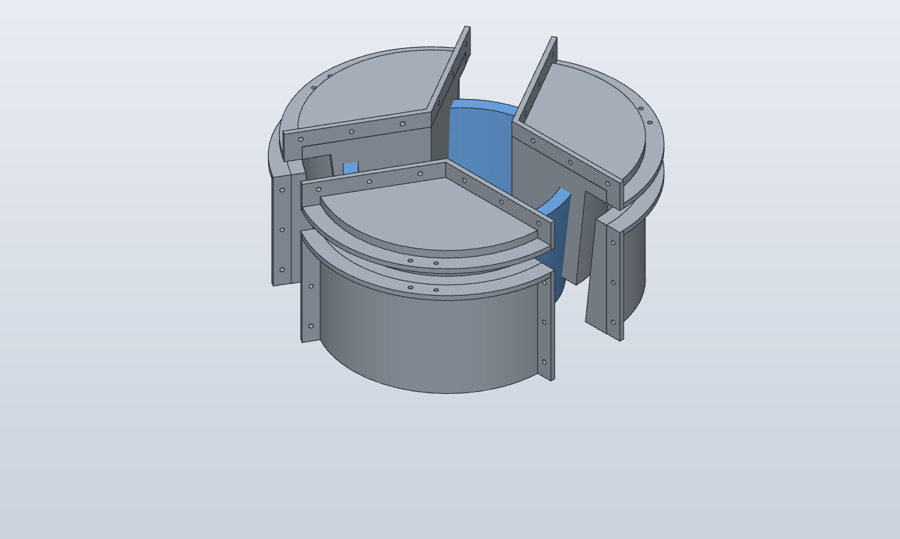
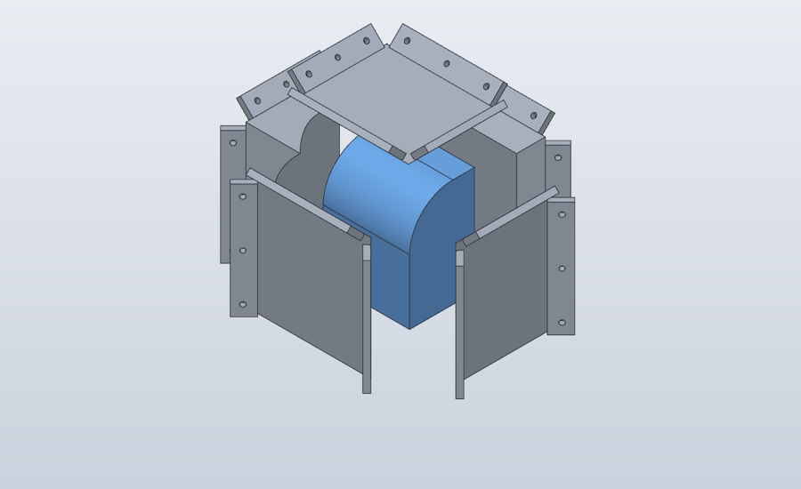
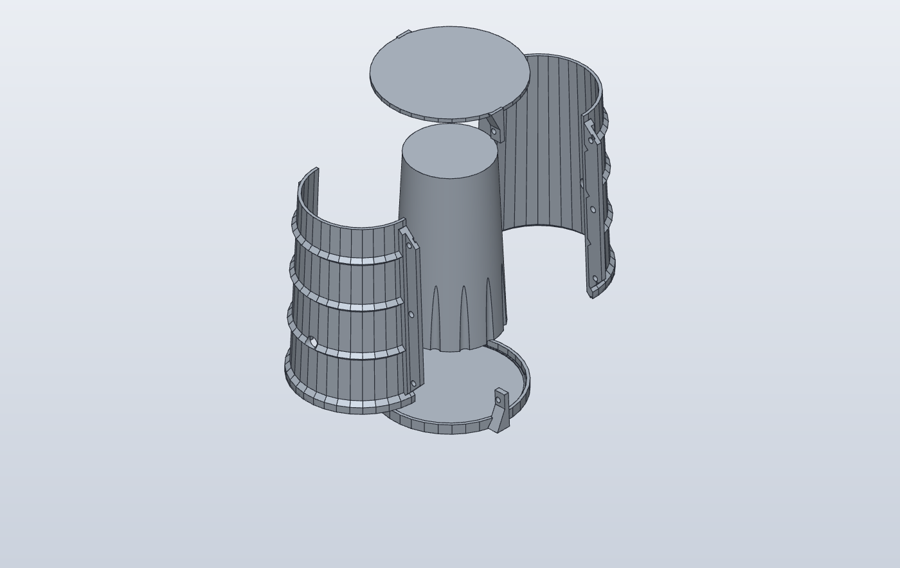

# Mould Maker

A SolidCraft plugin that turns a part into a 3D-printable mould, bolted together and split into
pieces that fit your printer. Made for casting concrete and GFRC (glass-fibre reinforced
concrete), where the part is cast with one face open: the face you pour into and trowel.

| Round mould | Box mould | Silicone sleeve mould |
|---|---|---|
|  |  |  |
| Bowls, planters, birdbaths | Flat-sided parts | Flutes, texture, undercuts |

## Install

1. You need **SolidCraft 0.41 or later**.
2. Download `mould-maker-<version>.zip` from the
   [latest release](https://github.com/Mechmoth/solidcraft-mould-maker/releases/latest). Don't
   unzip it.
3. In SolidCraft: **Plugins › Install plugin…** and pick the zip.

The menu now has **Round mould…**, **Box mould…** and **Silicone sleeve mould…**.

The plugin runs sandboxed: it can't read or write files, reach the network or see the clock.
Everything it makes is ordinary SolidCraft features, so a saved design opens without the plugin.

## Quick start

1. Open or draw the part. Imported STEP files work too.
2. Select the part. To choose the **open face** (the flat face you pour into and trowel), click
   that face instead. With the whole part selected, the open face is the part's bottom face.
3. Pick a mould from the **Plugins** menu, check the fields (hover a field's name for what it
   does) and click **Run**.

The part doesn't have to stand on its open face: the plugin turns a working copy, builds round
it and turns the pieces back. The whole mould is one undo step.

## The three moulds

### Round mould

For parts that are round about the open face's normal: bowls, planters, rings, birdbaths,
fountain basins.

- A **jacket** cut into sectors that pull off sideways.
- A **back plate** with the plug that fills the part's cavity, cut into rings and sectors that
  lift off.
- The plugin picks the fewest pieces that fit your printer (or set **Sectors** yourself).
- Optional **core pin** for one round side hole.

A square or strongly oval part is refused with a message pointing to Box mould.

**Big moulds take two runs.** One plugin run may make at most 256 SolidCraft commands and must
finish within 30 s. If the whole mould doesn't fit, the first run builds the jacket. Run
**Round mould…** again with the same part selected and it builds the back plate. SolidCraft 0.41
shows nothing when a plugin finishes, so if only the jacket appears, run it again.

### Box mould

For parts with flat or gently curved sides.

- **Four walls** that pull straight off sideways and a **back** that lifts off, split on mitres at
  the corners.
- Before touching the design, the plugin checks that every face of the part lets go of the piece
  that moulds it, and names the place if one doesn't.
- Recesses in the open face (pad seats, say) can't be cast in an open mould: they come out solid,
  so drill them afterwards.

### Silicone sleeve mould

For parts a rigid mould can't release: flutes, texture, small undercuts. A poured silicone liner
does the moulding; the printed pieces hold it.

The plugin makes five pieces:

| Piece | What it's for |
|---|---|
| Plug | The part itself, printed, to cast the silicone round |
| Sleeve A and B | A 3 mm shell split across the part's narrow sides, with hoops, bolting ears and pry slots |
| Silicone base | Holds the plug and the sleeve while the silicone is poured; sealing ridge and rod sockets |
| Casting base | Holds the sleeve and backs the silicone while the concrete is poured |

The run's result lists the silicone needed, the steel rods for any round holes through the part,
the bolts, and an estimate of the PLA for each piece.

**Process**

1. **Silicone.** Stand any lengthwise rods in their sockets in the silicone base and slide the
   plug over them, open face down. Put a thin bead of plasticine or sealant in the groove under
   the sleeve's foot, bolt the sleeve halves round the plug and to the base's lugs, and push any
   cross rods through. Tape the outside of the seams. Pour the silicone in one spot, right up to
   the sleeve's rim, and let it cure.
2. **Turn it over.** Pull the cross rods, turn the mould over onto the casting base and bolt it to
   the lugs. Lift off the silicone base, pull the lengthwise rods and the plug out.
3. **Concrete.** Put the rods back (waxed or greased), apply release agent, pour, vibrate and
   trowel flush with the rim.
4. **Demould.** Pull the rods, unbolt the sleeve (the pry slots help), peel the silicone off.

The sleeve's inside follows the part's outline grown by the silicone thickness, and tapers at no
more than the part's own draft, so the liner is never thinner than you set and slides out of the
sleeve.

## Fields

| Field | Round and box | Silicone | What it does |
|---|---|---|---|
| Printer | K1 Max | K1 Max | K1 Max (300 × 300 × 300 mm), or Custom to use the bed fields |
| Bed width, depth, height | 300 mm | 300 mm | Build volume, when Printer is Custom |
| Silicone thickness | | 10 mm | Silicone between part and sleeve. At least 10 mm; 12 to 15 mm for thick silicones or big parts |
| Wall | 20 mm | 3 mm | Mould thickness round the part |
| Back plate | 20 mm | | Plate on the side opposite the open face |
| Flange width | 25 mm | 16 mm | How far the flanges stand out; at least 2.5 × the bolt hole |
| Flange thickness | 16 mm | 10 mm | Both flanges of a joint together |
| Bolts | M6 | M5 | Clearance holes for M4, M5, M6 or M8; None for clamps |
| Dowel pins | 6 mm | 6 mm | One dowel hole per joint; 0 for none |
| Sectors (round) | 0 | | 0 picks the fewest pieces; 2 to 64 forces a count |
| Core pin diameter, angle, height (round) | 0 | | One side hole: diameter, direction from +X, centre height from the open face |
| Part body | | | Body name, if nothing is selected |

## Printing

- **Silicone sleeve halves:** stand them on either end. Nothing sticks out flat (hoops, ear ends,
  foot band and lip are all 45°), so they print without supports.
- **Bases:** plate down, supports off. The bolt holes in the lugs bridge cleanly.
- **Plug:** 2 walls and 5 to 10% infill is enough. Sand or coat it, because layer lines copy
  into the silicone.
- **Round and box pieces** are solid: print them with low infill.
- Turn on your slicer's **elephant's foot compensation** (about 0.2 mm), so split faces close flat.
- Sand or coat any printed casting face: layer lines show on the concrete.

Tested with PLA on a Creality K1 Max (0.6 mm nozzle, 0.3 mm layers, 3 walls, 15% infill).

## Limits

- Round mould: round parts only. The plug must lift straight out: a cavity that narrows going up
  is reported, not fixed.
- Box mould: no overhangs across the pull directions; walls bigger than the printer are refused,
  not split into strips.
- Round and box mould don't work on some parts imported from SolidWorks STEP: SolidCraft 0.41
  refuses booleans on them (see below). Silicone sleeve mould works on them, because it never
  cuts the part.
- The part is read from a coarse mesh (about 1/600 of its size), and round splits keep that much
  margin plus 1.5 mm from the part's faces.

## Build from source

    ./build.sh                 # Rust + wasm32-unknown-unknown target + wasm-tools
    BUILD_STD=1 ./build.sh     # without a prebuilt wasm32 std (uses -Zbuild-std)
    cargo test                 # unit tests
    SOLIDCRAFT_CLI=/path/to/solidcraft-cli python3 tests/cli_test.py      # round mould, test bowl
    SOLIDCRAFT_CLI=... python3 tests/cli_test.py design.sc Body '{"entry": "box-mould"}'
    SOLIDCRAFT_CLI=... python3 tests/cli_test.py design.sc Body '{"entry": "silicone-mould"}'

`tests/cli_test.py` runs the built plugin through SolidCraft's own plugin host
(`solidcraft-cli mcp --headless`) and checks the result: closed pieces, no overlaps, every piece
fits the printer, one undo step. `cargo run --release --example host_run -- <solidcraft-cli>
<design.sc> '<params>'` runs the same code natively and times every SolidCraft command.

## SolidCraft 0.41 notes

Found while building this; each is worked around in the plugin.

- `solid.mirror` makes invalid bodies of the tab shapes ("invalid B-rep record: flat arrays").
- Joins of bodies whose faces coincide exactly can fail ("Face Loop has zero area"), so tabs stay
  0.05 mm clear of the faces they meet.
- `body.rename` inside a plugin run, after an earlier plugin result was adopted, fails with
  "unknown body"; bodies are created under their final names instead.
- A taken `body_name` falls back to a session counter name (`Body18`).
- A boolean's cost is mostly per tool body and per hole, not per call.
- Booleans on a body imported from SolidWorks STEP (edge gaps up to 0.001 mm, accepted on import)
  fail SolidCraft's own result check ("Vertex-Face Gap exceeds XSectTol3d", 0.00001 mm), and
  `body.repair` finds nothing to repair.
- `model.mesh` and `model.faces` answer in the body's component coordinates, while
  `inspect.measure` and the selection answer in the design's. New bodies go into the active
  component, in its coordinates. The plugin reads placements from `component.list` and builds in
  the design's own component.
- The manifest may be at most 16 KB, and its description 240 characters.
- An edit entry that succeeds shows only "finished": its result, warnings and log aren't shown.

## Licence

MIT. See [LICENSE](LICENSE).
